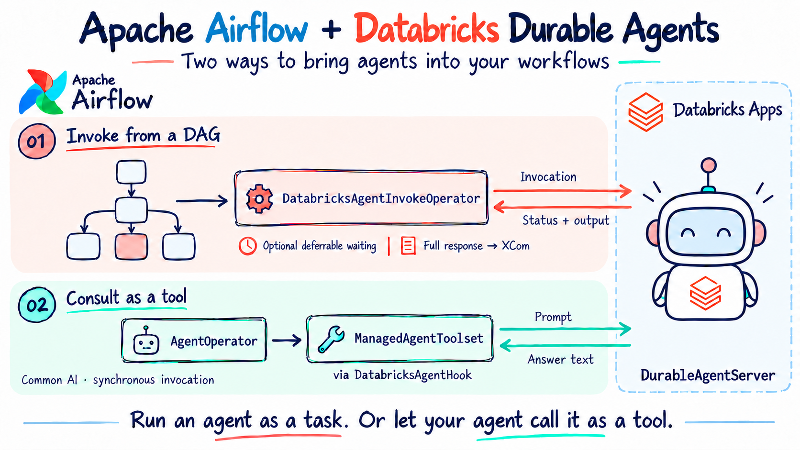

# Apache Airflow + Databricks Durable Agents

Local playground for testing `DatabricksAgentInvokeOperator`, `DatabricksAgentHook`, and the Common AI integration introduced in [apache/airflow#74386](https://github.com/apache/airflow/pull/74386).




Architecture adapted from the [Databricks agent compute stack](https://docs.databricks.com/aws/en/agents/deploy/). Airflow calls the invocation API exposed by `DurableAgentServer`, hosted on Agent Runtime on Databricks Apps. The operator, direct hook, and managed-agent toolset are three Airflow integration patterns for the same API.

The repository includes both sides: [`agent/`](agent/README.md) contains a deployable agent backed by a Databricks-hosted LLM, and [`dags/`](dags/) contains its three Airflow callers. `make up` deploys the agent, prepares `.env`, and starts Airflow in that order. The agent code runs in Databricks; Airflow stores the connection and invokes it remotely.

The Docker image extends `apache/airflow:slim-3.3.2-python3.12` and installs the Databricks provider directly from **`apache/airflow`'s `main` branch**, together with `common-compat` from the same reference to satisfy the development version's dependencies. Common AI is pinned to `1.0.0`, with the `openai` extra for the model used by `AgentOperator`. The slim image avoids dependency conflicts with unrelated providers bundled in the full image.

## 1. Authenticate once

Requirements: Python 3.11+, a current Databricks CLI, Docker with Compose v2,
`make`, and a workspace with Databricks Apps and an available text chat model.
Allow at least 4 GB of Docker memory; 8 GB is recommended.

```bash
databricks auth login --host https://YOUR-WORKSPACE.cloud.databricks.com --profile YOUR_PROFILE
```

Use a workspace profile, not an account-console profile. Your identity must be
allowed to create or manage the demo app, manage the caller service principal and
its OAuth secrets, and grant access to the app and model where necessary. Setup
cannot bypass workspace policies or make an unavailable model available.

## 2. Set up Databricks and start Airflow

```bash
make up DATABRICKS_PROFILE=YOUR_PROFILE
make password
```

`make up` performs the steps in order:

1. Checks your CLI login and model availability.
2. Reuses the configured app, or creates `airflow-durable-agent-demo` on first use.
3. Reuses the caller service principal, or creates a dedicated caller with workspace access. It validates the saved OAuth secret and creates a seven-day secret only when one is missing or rejected as invalid.
4. Ensures the caller has **CAN_USE** on the app. For models with a dedicated endpoint ACL, it adds **CAN_QUERY** for the app and caller where missing; shared foundation models use workspace access.
5. Starts app compute and deploys `agent/` if its code, dependencies, or selected model changed. Unchanged deployments are reused.
6. Obtains the app URL and a fresh caller LLM token, then writes the Airflow connections to `.env` with file permissions `0600`. Secrets are not printed or uploaded.
7. Builds and starts Airflow, loading the updated `.env`, and waits for its health check.

No need to copy URLs, client IDs, secrets, or tokens by hand. The selected profile,
app, and model are saved in `.env`, so subsequent runs need only `make up`.
Existing `.env` values such as `AIRFLOW_PORT` are preserved. A custom caller LLM
connection outside the Databricks workspace is preserved too.

To choose different resource names or an available model:

```bash
make up DATABRICKS_PROFILE=YOUR_PROFILE \
  DATABRICKS_APP_NAME=my-airflow-agent \
  DATABRICKS_MODEL_ENDPOINT=databricks-gpt-oss-20b
```

Command-line selectors override saved values. The initial model is GPT OSS 20B;
it is not available in every workspace. With the automatic workflow, choose the
model through the selector above or `.env`; setup renders the deployment's
`app.yaml` with that value without changing your source file. The first run with
an existing configuration discovers the app by its URL and reuses its caller.

`make setup` performs only the Databricks preparation and `.env` update.
`make up-local` starts only Docker, with the existing `.env`, and makes no
Databricks changes. `make up` starts cloud compute but does not run inference;
`make e2e` executes the DAGs and makes model requests.

Open <http://localhost:8080> and sign in with username `admin` and password `admin`.
This is the default for this local demo. To change it, set
`AIRFLOW_LOCAL_ADMIN_PASSWORD` in `.env` and run `make up-local`.
`make password` shows the configured password.
Compose runs PostgreSQL and `airflow standalone`, including the API/UI,
scheduler, DAG processor, and triggerer. DAGs are mounted from `dags/`, and local
state persists in Docker volumes. The UI binds only to `127.0.0.1`.

## 3. Run the DAGs

```bash
make e2e
# Run just the operator and direct-hook examples:
make e2e E2E_ARGS="--dag databricks_agent_invoke --dag databricks_agent_hook"
```

`make e2e` includes `make up`: it refreshes the configuration before running the
checks, skips an unchanged agent deployment, and reloads Airflow's environment.
The runner triggers the real DAGs, waits for task completion, and verifies XCom
results. It also checks the toolset DAG's transcript for a call and return from
`ask_databricks_agent`. The transcript is stored in `message_history` and may
contain prompts and agent output.

All DAGs have no schedule and start paused. The runner temporarily unpauses them,
restores their original setting, and keeps run history. To run a DAG manually,
unpause it in the UI and choose **Trigger DAG**. Refresh with `make up` first if
the environment has been idle beyond the caller LLM token's lifetime.

The caller LLM token lasts about one hour. It is renewed on every `make up` or
`make e2e`, not continuously while containers are running. The Databricks hook
and remote app manage their own access-token renewal. When the caller client
secret expires, the next setup creates a replacement using your CLI identity;
your CLI login must still work. No old secrets or cloud resources are deleted
automatically.

The runner waits up to 900 seconds per DAG; adjust this with `--timeout` in
`E2E_ARGS`. A timeout does not cancel remote work. To check only local readiness,
without changing Databricks or invoking agents:

```bash
make up-local
docker compose exec -T airflow python /opt/airflow-tools/run_end_to_end.py --check-only
```

## Manual connection configuration

For an existing deployment or a different authentication setup, use
`make init`, edit `.env`, and run `make up-local`. The
[manual agent deployment guide](agent/README.md#deploy-to-databricks-apps) describes
the cloud steps. `make up` is the automatic workflow and may redeploy the included
agent; use `up-local` when you want to retain a separately managed deployment.

| Variable | Value |
| --- | --- |
| `DATABRICKS_AGENT_APP_URL` | App HTTPS base URL, without `/api/invocations`. |
| `AIRFLOW_CONN_DATABRICKS_OAUTH` | Connection JSON: workspace `host`, caller client ID in `login`, secret in `password`, and `extra.service_principal_oauth=true`. |
| `AIRFLOW_CONN_PYDANTICAI_DEFAULT` | Caller LLM connection; needed only by `databricks_agent_as_tool`. |

The caller needs workspace access and **CAN_USE** on the app. The app's identity
needs model query access. These are separate service principals. Databricks Apps
require workspace OAuth; PATs do not work for these invocations. Environment
connections are resolved when tasks run and do not appear in the UI connection
list. `.env` is excluded from Git and the Docker build context.

`make refresh-llm-token` remains available to refresh only the Databricks caller
LLM connection; run `make up-local` afterward to load it. For a manual end-to-end
run without automatic cloud setup, use `docker compose exec -T airflow python
/opt/airflow-tools/run_end_to_end.py` after starting Airflow.

The included agent returns the model's answer, endpoint name, token usage, and
session ID. This minimal Apps deployment uses an in-memory Runtime Store and
does not demonstrate recovery across app restarts. Its API is `/api/invocations`;
Model Serving or MLflow `/responses` endpoints cannot replace the app URL.

## Examples

All DAGs use explicit operator instances. The hook example and downstream
response inspection tasks use `PythonOperator`; no TaskFlow decorators are used.

| DAG | What it tests | Requirements |
| --- | --- | --- |
| `databricks_agent_invoke` | Two independent invocations: synchronous polling and deferrable waiting. Each stores the full response in XCom, with a downstream task showing the answer and remote output. | App + OAuth. |
| `databricks_agent_hook` | `DatabricksAgentHook.agent(...).invoke(ManagedAgentRequest(...))`; retains normalized text, the full response, and the invocation reference, then inspects the remote output. | App + OAuth. |
| `databricks_agent_as_tool` | `AgentOperator` consults the app through `ManagedAgentToolset`; a downstream `PythonOperator` shows the final answer and remote responses. | App + OAuth + caller LLM connection. |

When triggering the first DAG, edit `agent_input` as a JSON object to match your agent's schema. The other two convert the prompt into `input.messages`, which is compatible with the Databricks templates. Adapt the code for agents with a different schema; Common AI also supports `vendor_options={"input_key": "question"}` to send the prompt under a different key.

In the first DAG, open the `return_value` XCom for `invoke_sync` or `invoke_deferrable` to inspect the full status and output. A fast agent may finish before you can observe the task in the `deferred` state. The triggerer starts with the environment.

In the hook DAG, `text` contains the normalized answer and `raw` preserves the full response envelope. In the toolset DAG, check the logs to confirm a call to `ask_databricks_agent`: the model decides when to call tools. This consultation runs synchronously in the worker and does not use the triggerer.

All inspection tasks (`inspect_sync`, `inspect_deferrable`, `inspect_hook`, and
`inspect_agent_response`) show the same object in their logs and `return_value`
XCom: `final_answer` and `databricks_responses`. For direct operator and hook
calls, `final_answer` is the remote agent's message. For `AgentOperator`, it is
the caller LLM's final answer after consulting the remote agent.
`databricks_responses` always contains a list of remote outputs, including the
message, model, token usage, and session ID returned by the included agent.
The toolset can call the remote agent more than once, so its list may contain
multiple outputs. Invocation status and IDs remain in the original operator or
hook XCom; the tool transcript exposes the remote output without that envelope.
Inspection only reads upstream XCom values; it does not invoke either agent again.

The examples disable automatic retries. The operator generates a stable UUID for each task/run/input/session; the direct hook example also preserves it when retrying or clearing the same task. A stored failed invocation requires a new UUID; triggering a new DAG run generates one. The toolset creates a new invocation for every call, so do not set a shared fixed UUID in its options. An Airflow timeout does not cancel the remote execution.

## Validate and develop

```bash
make check-setup           # Test setup reuse, credential handling, and env updates offline.
make check                 # Build, import all 3 DAGs, and serialize them; no Databricks calls.
make logs                  # Airflow component logs.
docker compose ps
make down                  # Stop the environment; preserve data.
```

`make check` prints the installed versions and the provider's source URL. To test against Databricks, trigger the DAGs with a configured app; import validation does not replace those integration tests.

Docker caches build layers. To pull the latest `main`, run `make refresh`. To pin the source to the merged PR, set `AIRFLOW_SOURCE_REF=7ac92c98ce63201de7b4bf9a59f0364088e7c447` in `.env` and run `make up`. This SHA pins the provider source, not all transitive dependencies.

To remove the local environment, including run history, connections stored in the database, the generated password, and logs:

```bash
docker compose down --volumes
```

This does not stop or delete the Databricks App. If you created one for testing, stop it in Databricks when you are done.

## References

- [Operator and hook guide on main](https://github.com/apache/airflow/blob/main/providers/databricks/docs/operators/agent.rst).
- [Common AI: AgentOperator](https://airflow.apache.org/docs/apache-airflow-providers-common-ai/1.0.0/operators/agent.html).
- [Common AI: ManagedAgentToolset](https://airflow.apache.org/docs/apache-airflow-providers-common-ai/1.0.0/toolsets/managed_agent.html).
- [Airflow in Docker](https://airflow.apache.org/docs/apache-airflow/3.3.2/howto/docker-compose/index.html).
